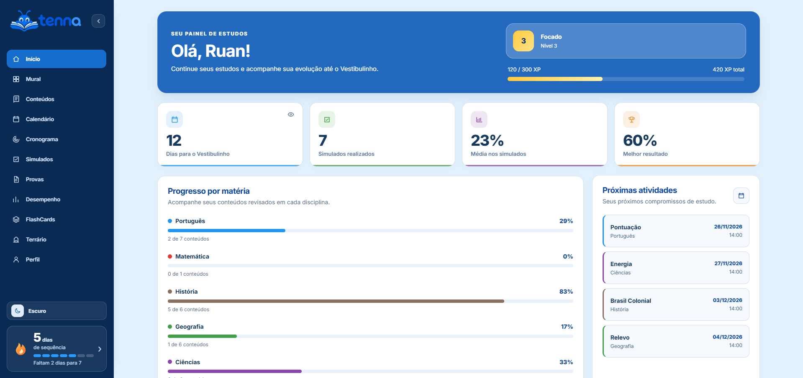

# TENNA — Plataforma de Estudos para o Vestibulinho


## Descrição

A TENNA é uma plataforma web educacional desenvolvida como Trabalho de Conclusão de Curso (TCC), com o objetivo de auxiliar estudantes na organização e no acompanhamento de sua preparação para o Vestibulinho.

O sistema reúne funcionalidades como cronograma de estudos, calendário, conteúdos, flashcards, banco de questões, simulados e acompanhamento de desempenho. Também conta com recursos de gamificação para incentivar a continuidade dos estudos.

## Equipe

- Maria Luiza Duarte de Moura — Documentação 
- Nícolas da Silva — Back-end
- Ruan Pablo dela Penha Banho — Front-end

## Tecnologias Utilizadas

- HTML5, CSS3 e JavaScript (ES Modules)
- React (19.2.8), React Router DOM (7.18.2) e Vite (8.2.1)
- Node.js (22.19.0) e Express (5.2.1)
- SQLite (3)

## Imagens do Projeto

### Página inicial



### Funcionalidade principal


## Como executar o projeto

### Pré-requisitos

- Node.js instalado
- npm instalado

### 1. Clonar o repositório

```bash
git clone URL_DO_REPOSITORIO
cd TENNA
```

### 2. Configurar o back-end

```bash
cd backend
npm install
```

Configure as variáveis de ambiente conforme o arquivo `.env.example` e inicie o servidor:

```bash
npm start
```

### 3. Configurar o front-end

Abra outro terminal na pasta principal do projeto:

```bash
npm install
npm run dev
```

Acesse o endereço disponibilizado pelo Vite no terminal.

## Como citar o projeto

[SOBRENOME], [Nome do aluno 1]; [SOBRENOME], [Nome do aluno 2]; [SOBRENOME], [Nome do aluno 3]. TENNA: Plataforma de Estudos para o Vestibulinho. 2026. [Número de páginas] p.

## Trabalho escrito

O trabalho escrito poderá ser consultado pelo Repositório Institucional do Centro Paula Souza:

https://ric.cps.sp.gov.br/