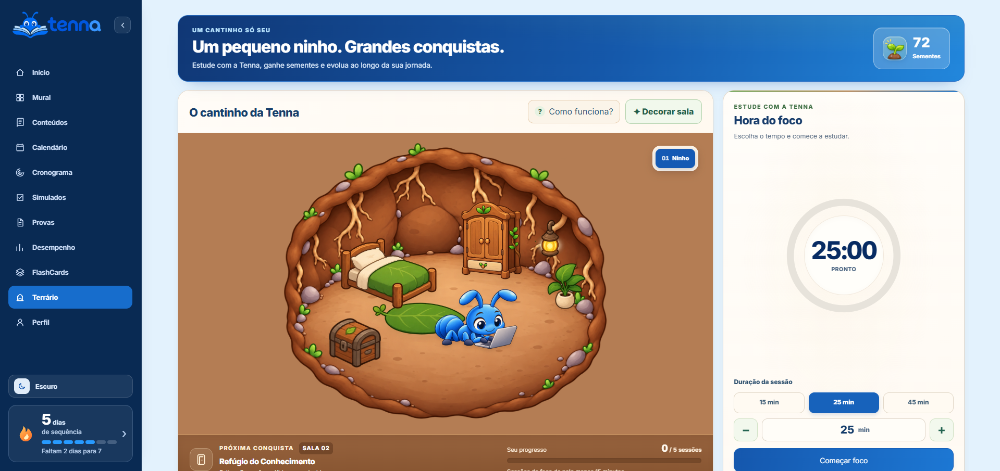

# TENNA
Desenvolvimento de uma plataforma web para apoiar a preparação de estudantes para o Vestibulinho da ETEC de Campo Limpo Paulista.

## Descrição
Muitos estudantes do Ensino Fundamental chegam ao Vestibulinho da ETEC sem uma rotina organizada de estudos, com materiais espalhados e sem saber como estão evoluindo. A TENNA é uma plataforma web que centraliza essa preparação em um só lugar.

O sistema reúne cronograma de estudos, calendário com as datas importantes do Vestibulinho, conteúdos por matéria, flashcards, simulados, provas anteriores e acompanhamento de desempenho. Também conta com recursos de gamificação (XP, conquistas e o Terrário) para incentivar a continuidade dos estudos. A plataforma possui dois perfis: o Aluno, que estuda e acompanha sua evolução, e o Administrador, que gerencia conteúdos, questões, simulados, provas e o calendário.

## Equipe
- Maria Luiza Duarte de Moura — Documentação
- Nícolas da Silva — Back-end
- Ruan Pablo Dela Penha Banho — Front-end

## Tecnologias Utilizadas
- HTML (5), CSS (3) e JavaScript (ES Modules)
- React (19.2.8), React Router DOM (7.18.2) e Vite (8.2.1)
- Node.js (22.19.0) e Express (5.2.1)
- SQLite (3), pelo pacote `sqlite3` (6.0.1)

## Algumas imagens para demonstrar o site desenvolvido

## Como executar o projeto (passo-a-passo)
Pré-requisitos: ter o **Node.js 22 (ou mais novo)** e o npm instalados. O projeto foi feito com o Node 22.19.0.

O projeto tem duas partes que rodam ao mesmo tempo: o **back-end** (pasta `backend`, porta 3000) e o **site** (pasta principal, porta 5173). Por isso serão usados dois terminais.

**1. Baixar o projeto**
- `git clone https://github.com/lopesnicolass/tcc.git`
- `cd tcc`

(ou baixar o ZIP pelo GitHub, extrair e abrir a pasta no VS Code)

**2. Rodar o back-end** (abrir o terminal em Terminal → Novo Terminal)
- `cd backend`
- `npm install`
- `cp .env.example .env` (no Windows sem Git Bash: `copy .env.example .env`)
- `npm start` → para rodar o back-end

Deve aparecer "Servidor rodando na porta 3000". Não fechar esse terminal.

**3. Rodar o site** (abrir outro terminal, botão + no painel do terminal)
- Entrar na pasta principal do projeto, onde está o `package.json` (a pasta `tcc`). Se o novo terminal abrir dentro de `backend`, use `cd ..`
- `npm install`
- `npm run dev` → para rodar o site
- O terminal vai mostrar um link (normalmente `http://localhost:5173`)
- Copiar o link e colar no navegador

Obs: o back-end e o site precisam estar rodando ao mesmo tempo. O `npm install` só precisa ser feito na primeira vez (uma vez em `backend` e outra na pasta principal). O banco de dados já acompanha o projeto em `backend/banco/vestibulinho.sqlite`.

**4. Primeiro acesso**
- **Aluno:** na página inicial, clicar em cadastrar, criar uma conta e entrar com ela.
- **Administrador:** no terminal do back-end, abrir o arquivo `backend/.env`, trocar `ADMIN_EMAIL` e `ADMIN_PASSWORD` (a senha precisa ter no mínimo 12 caracteres) e rodar `node criarAdmin.js`. Depois, entrar no site com esse e-mail e senha.

**Problemas comuns**
- *"Defina JWT_SECRET..." ao iniciar o back-end:* o arquivo `.env` não foi criado. Repetir o `cp .env.example .env` dentro da pasta `backend`.
- *O site abre, mas não carrega dados ou não faz login:* conferir se o back-end está rodando (passo 2) e se mostrou a mensagem da porta 3000.
- *Erro no `npm install` do back-end (sqlite3 ou bcrypt):* conferir se a versão do Node é a 22 e rodar o `npm install` de novo.
- *Mudou a porta do back-end (`PORT` no `.env`):* criar na pasta principal um arquivo `.env` com `VITE_API_URL=http://localhost:NOVA_PORTA` e reiniciar o `npm run dev`.

## Como citar o projeto
MOURA, Maria Luiza Duarte de; SILVA, Nícolas da; BANHO, Ruan Pablo Dela Penha. Desenvolvimento de uma plataforma web para apoiar a preparação de estudantes para o Vestibulinho da ETEC de Campo Limpo Paulista. 2026. 51 p.

Em caso de dúvidas entre em contato com nicolaslopessilva2008@gmail.com ou com ruanpablodelapenha@gmail.com

Para acessar o trabalho escrito do projeto: https://ric.cps.sp.gov.br/
