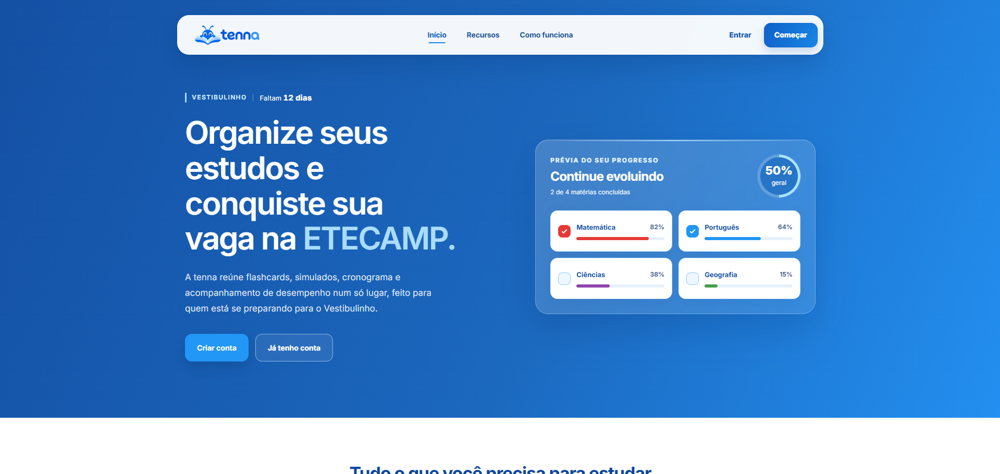
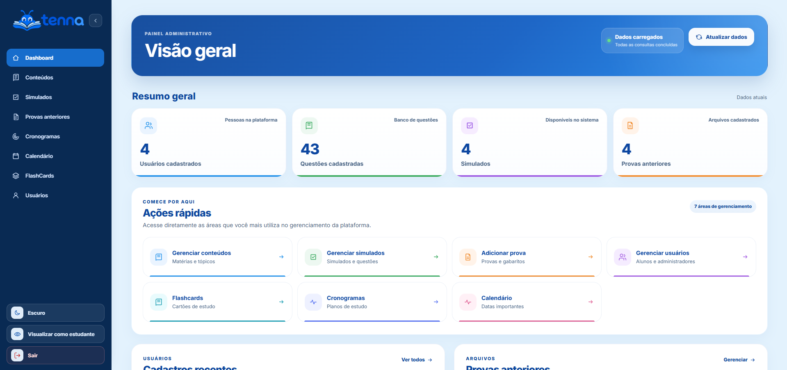

# TENNA
Desenvolvimento de uma plataforma web para apoiar a preparação de estudantes para o Vestibulinho da ETEC de Campo Limpo Paulista.

## Descrição
Muitos estudantes do Ensino Fundamental que desejam ingressar na ETEC de Campo Limpo Paulista chegam ao Vestibulinho sem uma rotina de estudos organizada, com materiais espalhados e sem clareza sobre a própria evolução. Diante disso, desenvolveu-se a TENNA, uma plataforma web que centraliza a preparação para o processo seletivo em um só lugar.

O sistema reúne cronograma, calendário com as datas importantes, conteúdos por matéria, flashcards, simulados, provas anteriores e acompanhamento de desempenho, além de recursos de gamificação, como XP, conquistas e o Terrário, que incentivam a continuidade dos estudos. A plataforma possui dois perfis: o Estudante, que organiza seus estudos, pratica e acompanha sua evolução; e o Administrador, que gerencia todos os materiais disponibilizados. Dessa forma, a plataforma visa contribuir para que os candidatos estudem de maneira mais estruturada, acompanhem seu progresso com autonomia e cheguem mais seguros ao Vestibulinho.

## Equipe
- Maria Luiza Duarte de Moura — Documentação
- Nícolas da Silva — Back-end
- Ruan Pablo Dela Penha Banho — Front-end

## Tecnologias Utilizadas
- HTML (5), CSS (3) e JavaScript (ES Modules)
- React (19.2.8), React Router DOM (7.18.2) e Vite (8.2.1)
- Node.js (22.19.0) e Express (5.2.1)
- SQLite (3), pelo pacote `sqlite3` (6.0.1)

## Algumas imagens para demonstrar o site desenvolvido

## Como executar o projeto (passo-a-passo)
Pré-requisito: ter o Node.js 22 (ou mais novo) instalado.

- Extrair o arquivo zip (será criada a pasta `TENNA-main`)
- Entrar no editor de código (exemplo: VS Code)
- Abrir a pasta `TENNA-main` extraída (Arquivo → Abrir Pasta)

Abrir o terminal (Terminal → Novo Terminal) e digitar:

- `cd TENNA-main`
- `cd backend`
- `npm install`
- `cp .env.example .env`
- `npm start` → para rodar o back-end

Não fechar esse terminal

Abrir outro terminal (botão + no painel do terminal) e digitar:

- `cd TENNA-main`
- `npm install`
- `npm run dev` → para rodar o site
- O terminal vai mostrar um link
- Copiar o link e colar no navegador

Obs: o back-end e o site precisam estar rodando ao mesmo tempo. O `npm install` só precisa ser feito na primeira vez.

**Acesso ao sistema**

| Perfil | E-mail | Senha |
| --- | --- | --- |
| Administrador | admin@tenna.com | MNRtenna26 |
| Estudante | criar uma conta na tela de cadastro | a senha escolhida (mínimo de 6 caracteres) |

## Como citar o projeto
MOURA, Maria Luiza Duarte de; SILVA, Nícolas da; BANHO, Ruan Pablo Dela Penha. Desenvolvimento de uma plataforma web para apoiar a preparação de estudantes para o Vestibulinho da ETEC de Campo Limpo Paulista. 2026. 49 p.

Em caso de dúvidas entre em contato com nicolaslopessilva2008@gmail.com ou com ruanpablodelapenha@gmail.com

Para acessar o trabalho escrito do projeto: https://ric.cps.sp.gov.br/
